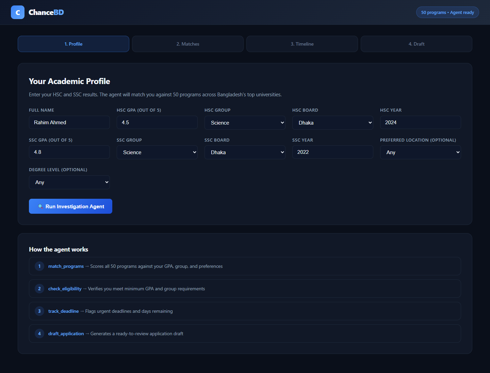
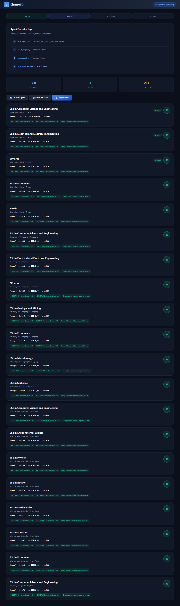
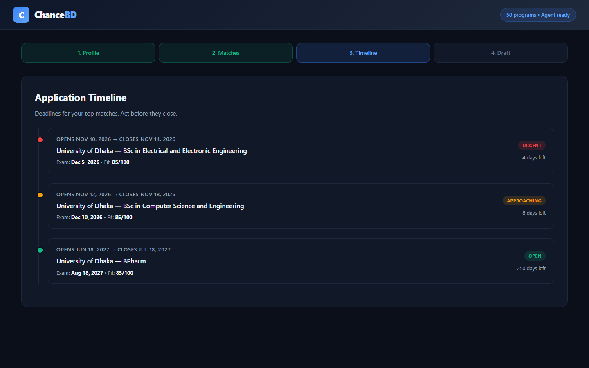
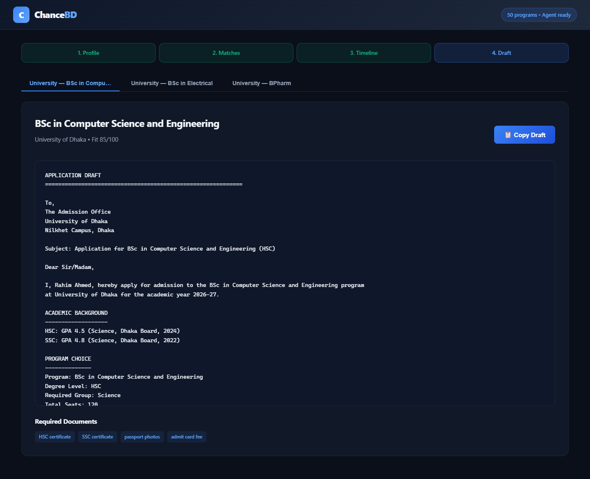
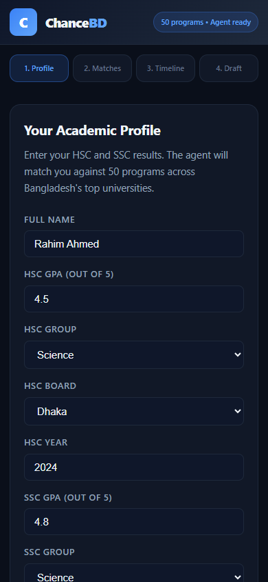

# ChanceBD — University Admission Agent

An AI-powered admission guidance agent for Bangladeshi students. Enter your HSC/SSC results and the agent matches you against 50 programs across Bangladesh's top universities, checks eligibility, tracks deadlines, and generates application drafts.

## Problem

University admission in Bangladesh is a chaotic maze of deadlines, eligibility rules, and required documents. Students miss chances they qualify for because:
- No single place shows which programs match their GPA, group, and board
- Deadlines are scattered across university websites
- Application requirements differ per program and are easy to miss

## How the Agent Works

ChanceBD uses a **bounded agent loop** with four deterministic tools:

| Step | Tool | What it does |
|------|------|--------------|
| 1 | `match_programs` | Scores all 50 programs against your GPA, group, board, and preferences |
| 2 | `check_eligibility` | Verifies you meet minimum GPA and group requirements |
| 3 | `track_deadline` | Flags urgent deadlines and days remaining |
| 4 | `draft_application` | Generates a ready-to-review application draft |

The agent is deterministic — same inputs always produce the same outputs. No AI hallucination, no hidden adjustments.

## Features

- **20 ranked matches** with fit scores and transparent reasons
- **Eligibility verification** with specific requirement checks
- **Deadline timeline** with Urgent / Approaching / Open / Closed status
- **Application drafts** with required documents list, ready to copy
- **50 programs** across DU, CU, JU, RU, SUST, and more
- **Agent execution log** showing exactly what the agent did

## Screenshots

| Profile | Matches |
|---------|---------|
|  |  |

| Timeline | Draft | Mobile |
|----------|-------|--------|
|  |  |  |

## Usage Guide

### 1. Fill your profile
1. Open the app → the **Profile** tab shows the academic form.
2. Enter your full name, HSC GPA, group, board, year, and SSC equivalents.
3. Optionally pick a preferred location and degree level.
4. Click **Run Investigation Agent**.

### 2. Review matches
- **20 match cards** ranked by fit score (green ≥ 70 strong, amber ≥ 40 possible, red below).
- Each card shows eligibility status, seats, tuition fee, and transparent **reason chips** (what you meet / what you don't).
- Top 3 stats: matches, eligible, strong fit.

### 3. Check deadlines
Open the **Timeline** tab → a chronological list of your top programs with:
- **Urgent** (≤ 7 days), **Approaching** (≤ 30 days), **Open**, or **Closed** badges
- Application start/close dates, exam dates, days remaining

### 4. Get your draft
Open the **Draft** tab → per-university application drafts with:
- Filled-in academic background and program choice
- Required documents checklist
- One-click **Copy Draft** to clipboard

### 5. Agent Log
The **Agent Execution Log** card above the matches shows the exact 4 tool calls the agent made — full transparency.


## Local Run

### Prerequisites
- Python 3.11+
- Node 18+

### Backend
```powershell
cd backend
python -m venv .venv
.\.venv\Scripts\python.exe -m pip install fastapi uvicorn pydantic
.\.venv\Scripts\python.exe -m app.seed
.\.venv\Scripts\python.exe -m uvicorn app.main:app --host 127.0.0.1 --port 8836
```

### Frontend
```powershell
cd frontend
npm install
npm run build
```

The backend serves the built frontend at **http://127.0.0.1:8836/**.

### Development Mode
```powershell
cd frontend
npm run dev
```
Proxies `/api` to `http://127.0.0.1:8836`.

## API

| Endpoint | Method | Description |
|----------|--------|-------------|
| `/api/health` | GET | Health check + program count |
| `/api/programs` | GET | List all 50 programs |
| `/api/profile` | POST | Save a student profile |
| `/api/investigate` | POST | Run the agent loop |
| `/api/investigations` | GET | List past investigations |
| `/api/investigations/{id}` | GET | Get investigation details |
| `/api/deadline/{program_id}` | GET | Check a program's deadline |
| `/api/draft/{program_id}` | POST | Generate a draft |

## Tech Stack

- **Backend:** Python 3.14, FastAPI, SQLite
- **Frontend:** React 18, TypeScript, Vite
- **Agent:** Deterministic tool loop (no external AI dependency)

## Honest Boundaries

- Program data is representative, not an official source. Always verify on university websites.
- The agent matches and drafts; it does not submit applications.
- Deadlines are static demo data and may not reflect real 2027 dates.
- No student data leaves your machine. All data stays in local SQLite.

## Verification

Run the automated browser verification:
```powershell
python verify.py
```
Takes screenshots of all four views and checks for console errors.